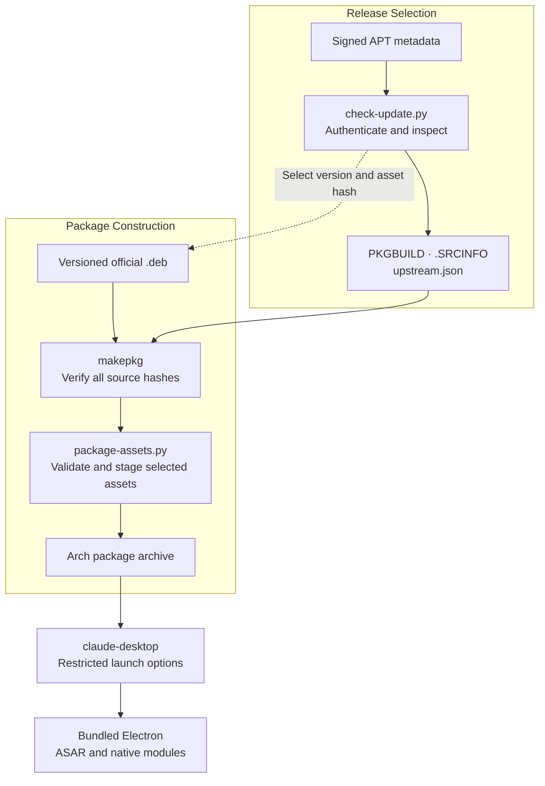
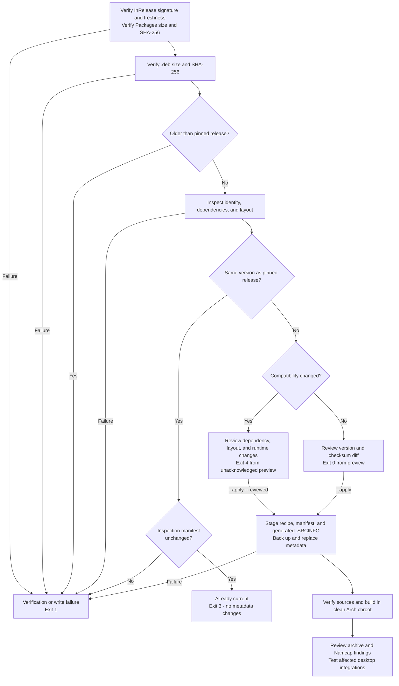

# Claude Desktop Sandboxed For Arch Linux

Arch Linux packaging of Anthropic's official Linux desktop application with required renderer sandboxing and a restricted launcher. The package is named `claude-desktop-sandboxed`, supports `x86_64`, and installs the `claude-desktop` command, desktop entry, icons, and protocol handlers. The independent Claude Code CLI can coexist with this package.

## Requirements

- Working unprivileged user namespaces. The package omits the setuid sandbox helper and provides no unsandboxed fallback.
- A graphical desktop session with a suitable desktop portal backend.
- A configured Secret Service provider or KWallet for credential storage.
- An ordinary user account for building and running the application.

## Packaging Architecture

Release selection and package construction have separate responsibilities. The updater authenticates a release through Anthropic's signed APT repository and records its inspected layout. The package build consumes that pinned versioned installer, verifies all source checksums, and stages selected application assets against the recorded baseline.



The upstream public signing key and release-selection tooling belong to the maintainer workflow. Building a pinned package uses the versioned installer, local helpers, and inspection manifest; it does not select a new release from APT. The package preserves the upstream executable and resource paths, replaces the launch command, and omits the setuid sandbox helper. See [Packaging Architecture](docs/Packaging-Architecture.md) for component responsibilities, installed paths, and runtime boundaries.

## Build And Install

Install the build tools and run these commands from the repository root:

```sh
sudo pacman -S --needed base-devel python curl gnupg
python scripts/check-update.py
makepkg -f --verifysource
makepkg -si
```

The updater authenticates the pinned release or previews a newer candidate; it does not apply changes without `--apply`. Exit code `3` means the pinned release is current and authenticated. Review newer candidates using the update procedure below before building them.

`makepkg -si` installs build dependencies, builds the package, and prompts for installation. Conflicting Claude Desktop packages must be removed in the installation transaction. Quit the application through its menu before upgrading, and retain the previous package and a backup of application data for rollback. Package rollback does not reverse application-data migrations.

## Launcher Configuration

The launcher selects native Wayland in a Wayland session. Set permitted overrides in `$XDG_CONFIG_HOME/claude-desktop-flags.conf`, defaulting to `~/.config/claude-desktop-flags.conf`, with one argument per line:

```text
# Select X11 for desktop compatibility.
--ozone-platform=x11
```

Comments begin with `#`. The configuration is parsed as arguments and never evaluated as shell code. Supported options cover Ozone platform selection, GPU disabling, device scale, supported Secret Service/KWallet stores, sandbox enabling, and startup mode. URI and file arguments are accepted.

Security-disabling switches, unrestricted feature switches, and remote debugging are rejected. This includes `--no-sandbox`, `--disable-web-security`, and `--password-store=basic`. The launcher clears Node/Electron entry-point environment overrides. This policy applies to the `claude-desktop` command; upstream relaunch and autostart paths can invoke the application executable directly.

## Updates And Validation

The updater verifies signed APT metadata with the pinned Anthropic key, checks metadata freshness and index integrity, then validates the versioned Debian asset, package identity, and application layout. Every package source has a SHA-256 checksum. Key rotation and failed authentication stop the update.



The diagram starts with a preview. Compatibility acknowledgment is a separate maintainer action; automation never supplies `--reviewed`. A successful metadata update is not a completed build or a desktop acceptance result.

Preview a release, then apply an accepted candidate:

```sh
python scripts/check-update.py
python scripts/check-update.py --apply
```

Use `--version VERSION` to select an exact release. Changes to dependency metadata, resource layout, native-module paths, or the Electron major version require manual review. After addressing those changes, `--apply --reviewed` acknowledges the compatibility gate; it cannot bypass authentication, checksums, archive validation, identity checks, or downgrade rejection. An unexpected ASAR entry point fails inspection with exit code `1` and requires a reviewed verifier change before the updater can accept it.

| Exit Code | Meaning |
| --- | --- |
| `0` | Candidate available, or update applied |
| `1` | Authentication, network, inspection, or write failure |
| `2` | Invalid command-line usage |
| `3` | Current authenticated release already packaged |
| `4` | Compatibility review required |

Applying a candidate updates `PKGBUILD`, `upstream.json`, and generated `.SRCINFO`. Do not run the updater concurrently with a build. Previous metadata is retained under `.cache/backups/`. If interruption leaves `.update-transaction.json`, restore all three files from its recorded backup, verify them, and remove the marker before updating or releasing again. File replacements are individually atomic, with rollback on ordinary write errors; they are not a single filesystem transaction.

For an official Arch clean-chroot build:

```sh
sudo pacman -S --needed devtools
makepkg -f --verifysource
extra-x86_64-build
```

Devtools normally skips integrity checks during the inner build. The extraction helper rechecks the upstream asset; repeat `makepkg -f --verifysource` inside a retained custom chroot to verify all sources there. A build with dependency checks disabled does not establish dependency completeness.

Development checks use `shellcheck` and `namcap` in addition to the build tools:

```sh
python -m unittest discover -s tests -v
bash -n PKGBUILD claude-desktop.sh
shellcheck claude-desktop.sh
makepkg --printsrcinfo > .SRCINFO.generated
diff -u .SRCINFO .SRCINFO.generated
namcap PKGBUILD /path/to/the-built-package.pkg.tar.zst
```

Review Namcap findings. Proprietary binaries can produce hardening, stripping, and dynamic-dependency warnings. The three Cowork compatibility symlinks also produce diagnostics because their targets are optional dependencies. New findings require investigation rather than broad suppression.

After installation, verify startup, actual renderer isolation, credential persistence after normal menu exit, protocol handlers, and the integrations affected by the release. Forced termination, login-session changes, MCP, Claude Code, and Cowork require their own acceptance tests.

See [Validation And Recovery](docs/Validation-And-Recovery.md) for source and archive checks, renderer evidence, updater recovery, and rollback boundaries.

## Runtime And Security

The package retains upstream's bundled Electron and does not modify ASAR contents. The application depends on executable identity, `process.resourcesPath`, and executable-relative paths for relaunch, autostart, MCP helpers, and Cowork. Native-module compatibility alone does not establish compatibility with a system Electron runtime.

Electron security updates therefore arrive through upstream Claude releases. The inspection manifest records Electron and Chromium versions; their presence does not establish that upstream ships the latest runtime patch.

The launcher passes `--enable-sandbox`. The package executes no Debian maintainer hooks and installs no setuid files, AppArmor exceptions, or kernel-setting changes. Renderer sandboxing does not isolate the main process, MCP servers, Claude Code tools, or user-authorized filesystem operations. GPU and utility processes can have different policies. Verify process isolation on the target system; see [Electron's sandbox documentation](https://www.electronjs.org/docs/latest/tutorial/sandbox).

Configure a credential service and verify encryption and persistence on the target desktop. Rejecting a launcher option cannot prevent upstream from internally selecting a weak credential fallback when no wallet is configured. See [Electron safeStorage](https://www.electronjs.org/docs/latest/api/safe-storage).

## Optional Features

| Feature | Packages Or Requirements |
| --- | --- |
| SSH connections | `openssh` |
| Claude Code command sandbox | `bubblewrap`, `socat` |
| Cowork virtual machine | `qemu-system-x86`, `edk2-ovmf`, `virtiofsd`, virtualization facilities, eligible account |
| Credential storage | Configured Secret Service or KWallet |
| Desktop portals | A suitable backend, such as `xdg-desktop-portal-kde` or `xdg-desktop-portal-gtk` |
| System tray | `libayatana-appindicator` where supported |

Cowork compatibility links expose Arch's virtiofsd and firmware under the paths expected by the application. Their targets are unavailable until the optional packages are installed. Recheck those paths when dependency packaging changes.

## Automation

GitHub Actions authenticates sources, runs tests and lint, and builds and installs the package in a clean Arch chroot. The daily upstream checker proposes ordinary updates through PRs. Compatibility changes require manual preparation and review; no workflow acknowledges compatibility changes or merges a PR automatically.

The AUR publisher validates the reviewed main commit and requires protected-environment approval before accessing its SSH credentials. It pins the AUR SSH host key and publishes only the seven package source files. CI retains validation reports without distributing application binaries. See [GitHub Actions And AUR Publication](docs/GitHub-Actions.md) for configuration, permissions, and release checks.

## License

Original packaging code and documentation are licensed under [MIT](LICENSE.md). Claude Desktop and bundled components retain their upstream terms. The package installs the upstream copyright notice and the packaging MIT notice. See [Third-Party Notices](Third-Party-Notices.md) for attribution and the scope of upstream signing and test materials.
