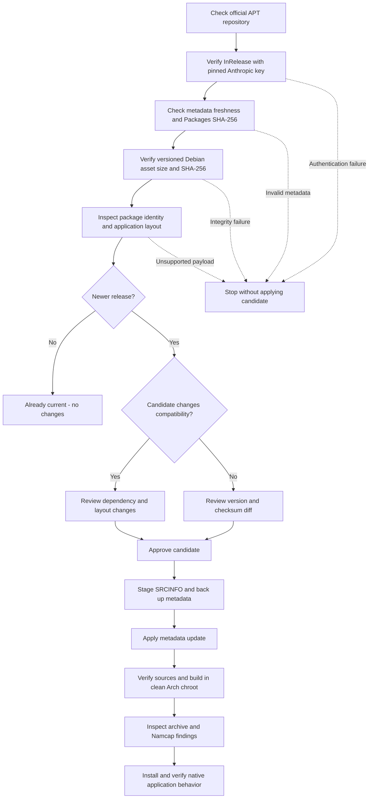

# Claude Desktop Sandboxed For Arch Linux

Unofficial Arch Linux packaging of Anthropic's official Linux desktop application. This repository contains the package recipe, an authenticated upstream updater, a restricted launcher, and regression tests. Application binaries are downloaded from Anthropic when building; they are not stored in this repository.

The package is named `claude-desktop-sandboxed` and supports `x86_64`. It provides the `claude-desktop` command, desktop entry, icons, and protocol handlers. It conflicts with packages installing the same desktop application, while the independent Claude Code CLI can coexist.

## Package Variant

This variant requires renderer sandboxing through unprivileged user namespaces and omits the setuid `chrome-sandbox` fallback. Its launcher restricts Chromium options, rejects switches that disable security features, and removes Node/Electron entry-point environment overrides. Systems without working unprivileged user namespaces cannot use this package; it does not fall back to an unsandboxed launch. These constraints distinguish it from general-purpose repackaging of the same official Linux asset. They do not modify or audit Anthropic's proprietary application code or isolate all application processes and tools.

The earlier personal package was named `claude-desktop-local`. The new package conflicts with it so an installation transaction can replace the old package explicitly. The executable, application directory, desktop identity, and profile paths retain their existing names. Quit the application normally before upgrading; verify credential persistence after restarting. The rename itself does not require moving or deleting the profile.

## Build And Install

Use an Arch Linux environment with working unprivileged user namespaces, a desktop portal backend, and a configured credential service. Build as an ordinary user.

Install the build and update tools, then run the following commands from the repository root:

```sh
sudo pacman -S --needed base-devel python curl gnupg
python scripts/check-update.py
makepkg -f --verifysource
makepkg -si
```

The updater previews a newer release; it does not apply changes or install the application unless explicitly requested. Exit code **3** means the pinned release is already current and authenticated. If a candidate is reported, follow [Updating The Package](#updating-the-package) before building that candidate. `makepkg -si` installs missing dependencies, builds the selected recipe, and asks to install the resulting package.

`-f --verifysource` checks sources even when a package artifact already exists; it does not rebuild the package. For an existing artifact, inspect and install one exact file:

```sh
sudo pacman -U ./claude-desktop-sandboxed-2.37337.1-3-x86_64.pkg.tar.zst
```

Replace that filename with the version built from the current PKGBUILD. Select an appropriate portal backend and keyring for the desktop. Optional components are described below.

## Authenticated Update Flow



The updater authenticates this chain:

1. `InRelease`, verified with the bundled public key and pinned primary fingerprint `31DDDE24DDFAB679F42D7BD2BAA929FF1A7ECACE`.
2. Signed release freshness, exact length and SHA-256 of the amd64 `Packages` index.
3. The exact `claude-desktop` amd64 stanza and its versioned official pool filename.
4. The downloaded asset's authenticated length and SHA-256, including every cached reuse.
5. Embedded Debian package metadata, ASAR identity, resource layout, native-module paths, and runtime versions.

The fingerprint is published in [Anthropic's installation documentation](https://support.claude.com/en/articles/10065433-install-claude-desktop). Key rotation fails closed: verify the replacement fingerprint through an official source before changing the bundled key and verifier. Replacement keys are not trusted automatically.

Every PKGBUILD source has a pinned SHA-256, including the versioned `.deb`, local helpers, and inspection manifest. Building the pinned version does not contact APT to select a new release; the updater performs that selection. Signature and checksum checks establish provenance and selected bytes, not the safety of proprietary upstream code.

## Updating The Package

Preview first, inspect the diff, then apply the selected candidate:

```sh
python scripts/check-update.py
python scripts/check-update.py --apply
```

To select an exact release:

```sh
python scripts/check-update.py --version VERSION
python scripts/check-update.py --version VERSION --apply
```

Changes to Debian dependencies, resource names, native-module paths, ASAR entry point, or Electron major require review. After checking and addressing those changes:

```sh
python scripts/check-update.py --version VERSION --apply --reviewed
```

`--reviewed` acknowledges the compatibility gate. It cannot bypass signatures, hashes, package identity, archive validation, or downgrade rejection. Electron minor/patch changes appear in the candidate report. Test every installed release even when its inspected layout is unchanged.

| Exit Code | Meaning |
|---|---|
| `0` | Candidate available, or update applied |
| `1` | Authentication, network, inspection, or write failure |
| `2` | Invalid command-line usage |
| `3` | Current authenticated release already packaged |
| `4` | Compatibility review required |

Applying an update changes `PKGBUILD`, `upstream.json`, and generated `.SRCINFO`. The updater rejects concurrent runs and preserves previous files under `.cache/backups/`. Do not run an updater concurrently with a build.

Replacements are atomic per file, with rollback on ordinary write errors, but are not one filesystem transaction. If `.update-transaction.json` remains after interruption, restore all three files from the relative backup path recorded in the marker, verify them, then remove the marker. Further updates are refused until recovery is complete.

## Clean Builds And Verification

Install `devtools` and use `extra-x86_64-build` for an official Arch clean-chroot build:

```sh
sudo pacman -S --needed devtools
makepkg -f --verifysource
extra-x86_64-build
```

Devtools verifies sources before entering its build chroot and normally uses `--skipinteg` during the build. The extraction helper independently verifies the upstream asset again. When using a retained custom chroot, an additional `makepkg -f --verifysource` inside that environment can verify all local sources there as well. A `makepkg --nodeps` build does not establish dependency completeness.

Run the repository checks and inspect the exact artifact:

```sh
python -m unittest discover -s tests -v
bash -n PKGBUILD claude-desktop.sh
shellcheck claude-desktop.sh
makepkg --printsrcinfo > .SRCINFO.generated
diff -u .SRCINFO .SRCINFO.generated
namcap PKGBUILD ./claude-desktop-sandboxed-2.37337.1-3-x86_64.pkg.tar.zst
```

Install `shellcheck` and `namcap` for those optional development checks. Tests cover signed-metadata tampering, key pinning, freshness, asset hashes, unsafe archive members, launcher input, compatibility gates, and update rollback. The signed fixture is used for signature tests; freshness cases use explicit test timestamps.

Namcap is not expected to be clean for proprietary repackaging. Known findings include upstream binaries lacking FULL RELRO/PIE, unstripped binaries, unused linked libraries, service/dynamic-loading dependencies, and the `/usr/libexec` compatibility path. Shared Node modules can also receive PIE diagnostics. Investigate new findings rather than broadly suppressing them.

Namcap's symlink rule considers package members and required dependencies, excluding optional dependencies. It therefore reports the three Cowork compatibility links even when their optional targets are installed. Verify those targets explicitly in an environment with the corresponding packages:

```sh
test -x /usr/libexec/virtiofsd
test -r /usr/share/edk2/OVMF_CODE_4M.fd
test -r /usr/share/edk2/OVMF_VARS_4M.fd
```

After installation, verify launch, actual renderer isolation, login persistence, protocol handlers, and the desktop integrations you use. Complete login, wait for the account view, quit through the application/tray menu, and reopen. Forced termination, logout/reboot keyring behavior, MCP, Claude Code, and Cowork require separate acceptance tests. Keep the previous package for rollback; package rollback does not reverse application-data migrations, so back up application data before upgrading.

## Runtime And Security Boundaries

The package retains upstream's bundled Electron. The application relies on its packaged executable identity, `process.resourcesPath`, and executable-relative behavior for relaunch, autostart, MCP helpers, and Cowork. Native-module compatibility with a newer system Electron is insufficient to establish those flows. The package does not patch ASAR contents or modify a system Electron installation.

Bundled Electron fixes arrive through upstream Claude releases, not system Electron updates. The inspection manifest records Electron and Chromium versions; the package does not guarantee upstream ships the latest runtime patch.

The launcher passes `--enable-sandbox`, rejects unrestricted debug/security switches, and clears Node/Electron entry-point environment overrides. Debian maintainer scripts are not executed. No setuid files, AppArmor exceptions, or kernel-setting changes are installed. The upstream `chrome-sandbox` helper is omitted, so working unprivileged user namespaces are required; there is no unsandboxed fallback.

Renderer sandboxing does not isolate the privileged main process, MCP servers, Claude Code tools, or user-authorized filesystem operations. GPU and utility processes can have different policies. Verify actual process isolation rather than inferring it from one command-line switch. See [Electron's sandbox documentation](https://www.electronjs.org/docs/latest/tutorial/sandbox).

Upstream can internally select a weak credential fallback on KDE when no wallet is configured. Rejecting `--password-store=basic` as launcher input cannot prevent application-internal selection. Configure a credential service and verify persistence and encryption on the target desktop; see [Electron safeStorage](https://www.electronjs.org/docs/latest/api/safe-storage).

## Launcher Configuration

The launcher selects native Wayland in a Wayland session. Configure permitted overrides in `$XDG_CONFIG_HOME/claude-desktop-flags.conf`, defaulting to `~/.config/claude-desktop-flags.conf`, with one argument per line:

```text
# Select X11 when needed for desktop compatibility.
--ozone-platform=x11
```

Comments start with `#`; the file is parsed as arguments and never evaluated as shell code. Supported options cover Ozone platform/hint selection, GPU disabling, device scale, supported Secret Service/KWallet stores, sandbox enabling, and startup mode. URI/file arguments remain available.

Options such as `--no-sandbox`, `--disable-web-security`, `--password-store=basic`, arbitrary feature switches, and remote debugging are rejected. Upstream autostart/relaunch entries can invoke its executable directly: this input policy applies to launches through `claude-desktop`, not all possible executions by the user.

## Optional Components

| Component | Packages / Requirements |
|---|---|
| SSH connections | `openssh` client tools |
| Claude Code command sandbox | `bubblewrap`, `socat` |
| Cowork virtual machine | `qemu-system-x86`, `edk2-ovmf`, `virtiofsd`, usable virtualization facilities, eligible account |
| Credential storage | Configured Secret Service or KWallet |
| Desktop portals | Suitable backend, such as `xdg-desktop-portal-kde` or `xdg-desktop-portal-gtk` |
| System tray | `libayatana-appindicator` where supported |

Optional dependencies allow chat-only installations; Cowork still requires its components. Compatibility links expose `/usr/lib/virtiofsd` under `/usr/libexec` and Arch's firmware under the Debian-style names expected upstream. They are dangling until optional targets are installed. Recheck these paths when dependency packaging changes.

## Repository Layout

```text
.
├── PKGBUILD                 # Arch package recipe and pinned sources
├── .SRCINFO                 # Generated package metadata
├── claude-desktop.sh        # Restricted application launcher
├── package-assets.py        # Validated asset staging
├── upstream.py              # APT authentication and payload inspection
├── upstream.json            # Reviewed upstream identity and layout
├── keys/anthropic.asc       # Pinned upstream public key
├── scripts/                # Updater, CI checks, and protected publishers
├── .github/workflows/      # Chroot validation, upstream PRs, and AUR release
├── docs/GitHub-Actions.md   # Automation setup and release boundaries
├── tests/                   # Regressions and signed metadata fixture
├── README.md
├── LICENSE.md
└── Third-Party-Notices.md
```

Build outputs, downloaded assets, cache/backup directories, updater locks, and local investigation files are ignored. A recovery marker is deliberately visible to Git so an interrupted update cannot be overlooked during release review. Restore the metadata and remove the marker before committing or releasing.

## GitHub Actions And AUR

The repository includes clean-chroot validation, a daily authenticated upstream check with ordinary update PRs, and an opt-in AUR publisher protected by environment approval and pinned SSH host keys. Compatibility changes require manual preparation and review; no workflow passes `--reviewed` or auto-merges a PR. AUR publication remains disabled until its environment, credentials, and enable variable are configured.

See [GitHub Actions And AUR Publication](docs/GitHub-Actions.md) for permissions, secrets, branch/environment protection, Namcap exceptions, and first-run acceptance. CI retains validation reports and does not distribute upstream application binaries.

## License And Provenance

Original packaging code and documentation are licensed under [MIT](LICENSE.md). Claude Desktop and bundled application components retain their upstream terms. The PKGBUILD lists `LicenseRef-Proprietary` for the application and `MIT` for the original launcher; it installs both upstream's copyright notice and the packaging MIT notice. Repository licensing does not relicense upstream assets. See [Third-Party Notices](Third-Party-Notices.md) for the public key and signed fixture scope.

The design reference is [diazkev314/claude-desktop-aur](https://github.com/diazkev314/claude-desktop-aur/tree/76ad64b77415983bbfb2f10a68031eda7adde0ab). This repository adds authenticated APT selection, bounded extraction, an inspection baseline, restricted launch flags, and staged metadata updates. It is independently maintained and is not an Anthropic project.
