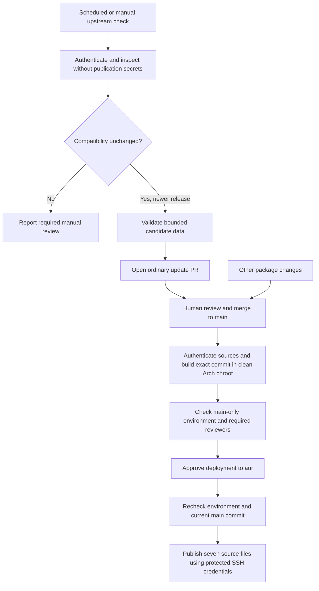

# GitHub Actions And AUR Publication

The workflows authenticate upstream releases, build in an official Arch clean chroot, propose ordinary updates, and publish reviewed package sources to AUR. Publication is disabled until explicitly configured. No application binary or Debian installer is uploaded as a GitHub artifact.

## Workflow Boundaries



| Workflow | Triggers | Credentials And Result |
|---|---|---|
| `validate.yml` | Pull requests, pushes to `main`, manual runs, reusable calls | Read-only GitHub token; authentication, tests, lint, source checks, clean-chroot build/install, archive checks, and reports |
| `upstream.yml` | Daily at 06:23 UTC and manual runs on `main` | Inspection job has no publication secrets; separate PR job uses `UPSTREAM_PR_TOKEN` only for ordinary candidates |
| `publish-aur.yml` | Package/publishing changes merged to `main`, or manual runs | Disabled unless `AUR_PUBLISH_ENABLED=true`; validates the same commit, checks environment policy, waits for approval, and uses environment-scoped SSH secrets |

Actions are pinned to full commit IDs, and the Arch bootstrap image is pinned to its manifest digest. Arch tools and chroot dependencies are updated from signed official repositories for each run. This intentionally tests the current Arch environment; package output is not claimed to be bit-for-bit reproducible across repository updates. Review changes to action pins, the image digest, CI scripts, and workflow permissions through ordinary PRs.

The validation container needs `--privileged` for `systemd-nspawn`. Its `/run` is a temporary filesystem, and bootstrap initializes the container's machine ID and local pacman signing key before creating the chroot. The key is ephemeral and signs local pacman trust records; it is unrelated to AUR SSH credentials. Package signatures remain required. A CI-only `systemd-nspawn` adapter adds `--keep-unit` to reuse the Docker job's cgroup instead of requesting a scope from an absent system manager. Devtools still supplies `--register=no`, and its namespace/isolation arguments are preserved. The adapter is installed only inside the disposable validation container, never by the package or local build script. The container runs on a disposable GitHub-hosted VM with no publication credentials. Use GitHub-hosted runners for these workflows; do not execute untrusted PR recipes on a persistent runner containing private data or credentials. Workflows never use `pull_request_target` or a privileged `workflow_run` artifact handoff.

## Repository Setup

Publish the source repository with `main` as its default branch. Enable GitHub Actions and protect `main`: require PRs and the `Arch Source And Chroot` validation check from the GitHub Actions app, up-to-date branches, resolved conversations, no administrator bypass, and no force pushes or deletions. For a sole maintainer, set required approvals to zero and review/merge PRs manually; an independent-review policy requires another eligible approver. Prevent automatic merging of compatibility changes. The protected AUR environment does not substitute for source-code review. A person who can change workflows on `main` controls the release implementation.

Configure these values in GitHub's repository settings:

| Scope | Name | Purpose |
|---|---|---|
| Repository secret | `UPSTREAM_PR_TOKEN` | Fine-grained token restricted to this repository with **Contents: Read and write** and **Pull requests: Read and write**; no Actions, administration, or workflow write access |
| Repository variable | `AUR_PUBLISH_ENABLED` | Literal `true` enables the AUR pipeline; leave unset while preparing the first release |
| `aur` environment secret | `AUR_SSH_PRIVATE_KEY` | Dedicated unencrypted SSH private key whose public key is registered on the intended AUR account |
| `aur` environment secret | `AUR_KNOWN_HOSTS` | Independently verified SSH host-key entries for the literal host `aur.archlinux.org` |
| `aur` environment variable | `AUR_COMMIT_NAME` | Maintainer name used for AUR Git commits |
| `aur` environment variable | `AUR_COMMIT_EMAIL` | Maintainer email used for AUR Git commits |

The dedicated PR token is necessary because events created with the default `GITHUB_TOKEN` generally do not trigger further workflows. A PR created with the separate token can run the normal validation workflow. Missing or expired credentials fail the candidate publication job; inspection still leaves its authenticated report. See [GitHub's Workflow Trigger Documentation](https://docs.github.com/en/actions/how-tos/write-workflows/choose-when-workflows-run/trigger-a-workflow).

Create an environment named **`aur`** before enabling publication:

1. Configure at least one **required reviewer**. Allow self-review if a sole maintainer must approve their own deployment; otherwise enable prevention of self-review. Prefer disabling administrator bypass where available.
2. Set deployment branches/tags to **Selected branches and tags**. Add exactly one **branch** policy named `main`; add no wildcard or tag policies. Choosing “Protected branches only” does not satisfy this workflow's explicit policy check.
3. Store the SSH key and verified host entries as environment secrets, not repository secrets. Configure the two commit-identity environment variables.
4. Confirm the AUR account may create or maintain `claude-desktop-local`, review the AUR submission requirements and package naming, and check for an existing package before the first publication.
5. Enable `AUR_PUBLISH_ENABLED`, dispatch `Publish AUR` from `main`, inspect the completed validation, and approve the deployment.

The jobs read the environment policy through GitHub's API before and after approval. Missing reviewers, additional branch/tag policies, a deleted environment, or a stale main commit stop publication. This guards against accidentally creating an unprotected environment merely by naming it in a workflow. Environment protection features depend on repository visibility and the GitHub plan; use a repository configuration that supports required reviewers. See [GitHub's Environment Documentation](https://docs.github.com/en/actions/reference/workflows-and-actions/deployments-and-environments) and [Environment REST API](https://docs.github.com/en/rest/deployments/environments).

Generate the dedicated key outside the repository, register only its public half with AUR, and enter its private half directly in GitHub's environment-secret settings. Never commit the key or paste it into an issue, workflow log, or update PR. `AUR_KNOWN_HOSTS` accepts explicit Ed25519, ECDSA, or RSA host entries; it rejects wildcards, certificate-authority markers, alternate hostnames, and hashed entries. Verify their fingerprints against an authoritative Arch source or a previously authenticated connection before storing them. The workflow does not bootstrap trust with `ssh-keyscan`. Consult [AUR Submission And SSH Authentication](https://wiki.archlinux.org/title/AUR_submission_guidelines).

## Validation And Reports

`scripts/ci-check.sh` validates the source snapshot, runs the regression suite, Bash syntax checks, ShellCheck, Actionlint, and `.SRCINFO` regeneration. It authenticates the pinned version through the signed APT repository and runs `makepkg -f --verifysource`. An upstream removal of the pinned version, expired signed metadata, or key rotation fails authentication rather than silently selecting another release.

`scripts/ci-build.sh` creates an official Arch base and a fresh devtools working copy, builds as an ordinary user, installs the result **inside the chroot**, and runs Namcap. It explicitly repeats source-integrity checks inside the chroot and verifies installed files with `pacman -Qkk`. `ci-namcap.sh` also checks the actual lint process status, since the devtools logging pipeline can mask a lint-tool failure. Archive checks require root-owned members, no setuid/setgid bits, no `.INSTALL`, no `chrome-sandbox`, and the exact reviewed launcher and packaging license. It records `.BUILDINFO`, a package SHA-256, and logs in `.ci-output/`. GitHub retains these diagnostics for seven days; proprietary build artifacts stay on the disposable runner.

New Namcap errors fail validation. The only accepted errors are the exact three documented optional Cowork symlink diagnostics for `virtiofsd`, `OVMF_CODE_4M.fd`, and `OVMF_VARS_4M.fd`; they remain visible in the log. Warnings remain visible and require review when their meaning changes. CI does not establish native desktop rendering, renderer isolation, credential persistence, MCP, or Cowork behavior. Test the integrations affected by each release on a desktop before approving publication.

## Ordinary And Compatibility Updates

The periodic inspector applies only a candidate accepted by the existing compatibility gate. It never passes `--reviewed`. Its outcomes are:

- **Current:** leave an authenticated report without a PR.
- **Ordinary candidate:** transfer only `PKGBUILD`, `.SRCINFO`, `upstream.json`, and a bounded report to the PR job. Validate the candidate against the trusted renderer before creating a version/hash-specific branch and PR.
- **Compatibility change:** report `review_required` in the run summary and retained report; create no automatic PR and apply no compatibility acknowledgment. Review and prepare the change manually using the documented `--version VERSION --apply --reviewed` flow, then submit a PR.
- **Verification failure:** fail the run and retain available diagnostics.

Enable notifications for failed scheduled runs and inspect the `Check Upstream` run summaries for compatibility reports. A compatibility report is a successful inspection requiring a manual action, not an authentication failure.

The PR job never force-pushes. An existing open, merged, or closed PR for the same version/hash is preserved. A candidate branch without a PR stops for manual recovery; inspect that branch and open the PR manually if a previous PR-creation attempt failed. Review the authenticated version/hash diff, runtime versions, Namcap log, and test/build result before merging. No workflow auto-merges a PR.

### Testing The PR Token

After storing `UPSTREAM_PR_TOKEN`, manually run `Check Upstream` from `main` with **test_pr_token** enabled. If the authenticated release is current, a separate job creates a clearly marked draft PR changing only `docs/Upstream-PR-Token-Test.md`. The test exercises the stored token's branch-push and PR-create permissions and checks that the normal PR validation workflow starts. It does not invent an application version, change package metadata, or acknowledge compatibility changes. Verify the required check, then close the draft without merging it. Existing PRs or remote branches from the same run are preserved on retries.

The option defaults to false and is ignored by scheduled runs. A real ordinary candidate still uses the production update-PR path; compatibility changes still require manual review. A document-only token test and offline candidate-validation tests do not establish that a future authenticated release will create its update PR successfully.

## AUR Source Transaction

Publication uses the fixed endpoint `ssh://aur@aur.archlinux.org/claude-desktop-local.git` and the AUR `master` branch. It copies exactly:

```text
PKGBUILD
.SRCINFO
claude-desktop.sh
upstream.py
package-assets.py
upstream.json
LICENSE.md
```

The signing key and inspection/updater tooling used to choose a release are maintained on GitHub; `makepkg` needs only the seven published files and the pinned official download. Documentation, tests, CI files, caches, and logs are not mirrored to AUR.

The publisher parses package data without sourcing the recipe or running build code in the credential-bearing job. It checks local-source hashes, manifest agreement, the exact checkout SHA, regular-file limits, fixed package identity, and strict upstream source URLs. It refuses unexpected remote files or modes, downgrades, and changed contents under an unchanged version/release. Increment `pkgrel` for packaging changes. An identical snapshot is a no-op; concurrent remote changes are rejected by an ordinary non-forced push.

The SSH key is written only to a private temporary directory, with mode `0600`, and removed when the publisher exits normally or raises an error. SSH disables inherited configuration, requires the specified identity and pinned host keys, and uses batch mode. Process termination can defer cleanup until the disposable runner is destroyed. Existing AUR layouts that contain additional files require a reviewed migration; automation does not remove unknown remote files.

## First-Run Acceptance

Local tests exercise policy failures, canonical update validation, and source transactions against disposable Git repositories. They do not validate hosted runner mounts, GitHub API access, token scopes, environment settings, or AUR permissions.

Before relying on automation, complete one manual hosted validation run, one `Check Upstream` run, and one approved AUR run. Verify that an unprotected/misconfigured environment is refused and that a newer main commit blocks an older pending release. Review the seven published AUR files and the actual SSH host-key verification. Keep publication disabled until this configuration is ready.
