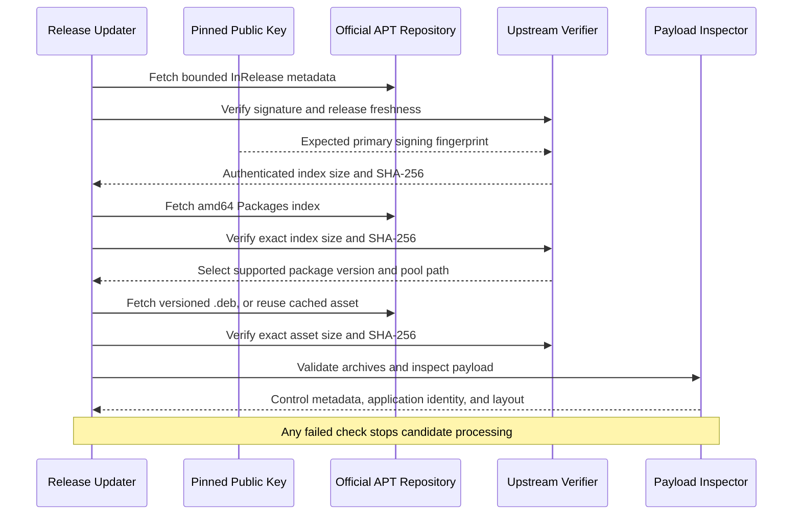
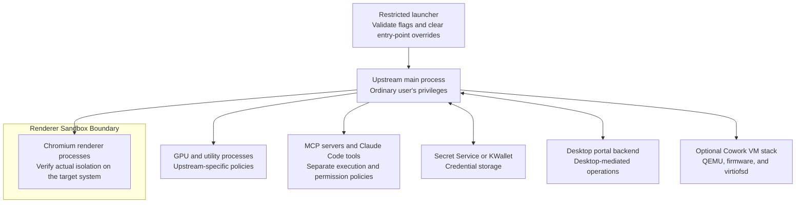

# Packaging Architecture

The package adapts Anthropic's official Linux desktop payload to Arch Linux while preserving its executable identity and resource layout. Release selection, package construction, runtime launch policy, and source publication are separate operations with distinct trust inputs.

## Components And Responsibilities

| Component | Inputs | Responsibility | Outputs |
| --- | --- | --- | --- |
| `upstream.py` | Pinned key, signed APT metadata, versioned Debian asset | Verify provenance and size/hash constraints; validate archives; inspect application identity and layout | Authenticated package metadata and inspection data |
| `scripts/check-update.py` | Authenticated candidate, existing recipe and manifest | Preview changes, enforce compatibility review, render checksums, generate `.SRCINFO`, and back up metadata before applying | Updated `PKGBUILD`, `upstream.json`, and `.SRCINFO` |
| `PKGBUILD` | Five local sources and one versioned `.deb`, each with SHA-256 | Describe dependencies and assemble the Arch package from validated staging | Arch package archive |
| `package-assets.py` | Pinned asset and reviewed `upstream.json` | Recheck asset bytes and inspection data; copy selected assets; remove privilege bits and the setuid helper | Application and integration staging directory |
| `claude-desktop.sh` | Permitted CLI arguments, optional flags file, desktop session | Apply launch policy and execute the packaged runtime | Application process |
| CI and publishers | Reviewed source checkout and bounded metadata | Validate a source snapshot, propose ordinary updates, or publish approved package sources | Reports, update PRs, and source commits |

`upstream.json` is the reviewed inspection baseline. Its package section records version, architecture, pool filename, size, and SHA-256. Its inspection section records Electron/Chromium versions, dependency fields, the ASAR entry point, resource names, and native-module paths. It is not a runtime configuration file.

## Upstream Authentication

Trust begins with `keys/anthropic.asc` and the pinned primary fingerprint in the verifier. The signed release supplies the index digest; the verified index supplies the asset digest. Cached assets are reverified before reuse. Same-version changes to the authenticated manifest are rejected rather than silently replacing the baseline.

The Debian container must have the expected control and payload archives. Archive validation rejects traversal, duplicate paths, special files, hardlinks, escaping symlinks, and excessive member counts or expanded sizes. Debian control metadata is parsed as data; maintainer scripts are not executed.

The compatibility gate compares dependencies, resource names, native-module paths, and the Electron major version. The ASAR entry point is also recorded and compared, but payload inspection first requires the supported `.vite/build/index.pre.js` entry point. A different entry point therefore fails inspection rather than producing an acknowledgeable compatibility report; accepting it requires a reviewed verifier change. Acknowledging review does not weaken signature, checksum, archive, identity, or downgrade checks. See [the update flow](../README.md#updates-and-validation).

## Build Boundary

`makepkg` checks six source hashes. `prepare()` invokes `package-assets.py`, which independently verifies the upstream asset against the manifest and requires the inspected payload to match the reviewed baseline. The extraction helper selects:

- `/usr/lib/claude-desktop`, including the upstream executable, bundled Electron components, ASAR resources, and native modules.
- The upstream desktop entry and hicolor icons.
- The upstream copyright notice.

The helper removes setuid/setgid bits from staged regular files and omits `chrome-sandbox`. `package()` installs a restricted `/usr/bin/claude-desktop` launcher, license notices, and optional Cowork compatibility links. It does not reproduce Debian repository registration, AppArmor exceptions, or kernel settings.

| Installed Path | Purpose |
| --- | --- |
| `/usr/bin/claude-desktop` | Restricted launch entry point |
| `/usr/lib/claude-desktop/claude-desktop` | Upstream executable identity used by application integrations |
| `/usr/lib/claude-desktop/resources/app.asar` | Upstream application code, retained without patching |
| `/usr/lib/claude-desktop/resources/app.asar.unpacked` | Unpacked resources and native modules |
| `/usr/share/applications/com.anthropic.Claude.desktop` | Desktop and protocol integration |
| `/usr/share/icons/hicolor` | Application icons |
| `/usr/share/licenses/claude-desktop-sandboxed` | Upstream and packaging license notices |

The upstream public signing key and release-selection tooling are not required to build the pinned package. The seven published package files are the recipe, generated metadata, launcher, verifier, staging helper, inspection manifest, and packaging license. The versioned asset is downloaded from the official pool during the build.

## Runtime Boundaries

The main process runs as the invoking user, not as root. It has capabilities that sandboxed renderers do not. Passing `--enable-sandbox` is a requested runtime policy; release acceptance must verify renderer arguments, process state, and namespace isolation rather than assuming every process has the same restrictions.

The launcher restricts options and clears `ELECTRON_RUN_AS_NODE`, `ELECTRON_NO_SANDBOX`, `NODE_OPTIONS`, and `NODE_PATH`. This applies to launches through the wrapper. Upstream relaunch/autostart paths and direct execution of the packaged binary can bypass the wrapper's input policy. User-authorized MCP, tool, filesystem, and VM operations have their own boundaries.

Credential persistence depends on the upstream application and the configured desktop credential service. The package does not implement a credential store. A configured wallet, encrypted storage, and normal-exit persistence require separate validation; rejecting `--password-store=basic` at the wrapper cannot prevent an application-internal fallback.

## Bundled Runtime Compatibility

The bundled Electron runtime preserves executable-relative behavior, `process.resourcesPath`, native-module loading, and upstream relaunch/integration paths. Replacing it with a system Electron runtime requires validation of those contracts, not only native-module ABI compatibility. This package does not patch the ASAR or replace the runtime.

The manifest records bundled runtime versions for review. Runtime fixes arrive with upstream Claude releases; the record does not guarantee that upstream includes the latest Electron security patch.

## Optional Cowork Paths

| Compatibility Link | Target | Required Optional Package |
| --- | --- | --- |
| `/usr/libexec/virtiofsd` | `/usr/lib/virtiofsd` | `virtiofsd` |
| `/usr/share/edk2/OVMF_CODE_4M.fd` | `/usr/share/edk2/x64/OVMF_CODE.4m.fd` | `edk2-ovmf` |
| `/usr/share/edk2/OVMF_VARS_4M.fd` | `/usr/share/edk2/x64/OVMF_VARS.4m.fd` | `edk2-ovmf` |

These links can be dangling in a chat-only installation. Cowork additionally requires QEMU, suitable virtualization facilities, and upstream account eligibility. Link availability and a successful package build do not establish a working VM session.

## Maintenance And Publication

Source authentication establishes provenance and selected bytes; it does not audit proprietary application behavior. CI validates packaging in an official Arch chroot, while desktop acceptance checks runtime integrations. [Validation And Recovery](Validation-And-Recovery.md) defines those checks. [GitHub Actions And AUR Publication](GitHub-Actions.md) describes credential separation, data handoffs, and protected source publication.
