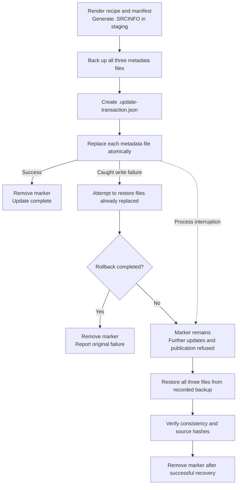

# Validation And Recovery

Validation has three layers: authenticate the selected sources, verify the built package, and exercise the desktop integrations affected by the release. Passing one layer does not establish the others.

## Source And Metadata Checks

Run checks as an ordinary user from the repository root:

```sh
python scripts/check-update.py --version VERSION
makepkg -f --verifysource
makepkg --printsrcinfo > .SRCINFO.generated
diff -u .SRCINFO .SRCINFO.generated
python -m unittest discover -s tests -v
bash -n PKGBUILD claude-desktop.sh scripts/ci-*.sh
shellcheck claude-desktop.sh scripts/ci-*.sh
actionlint .github/workflows/*.yml
```

Replace `VERSION` with the version pinned in `PKGBUILD`. An authenticated no-change result exits with code `3`; it is not an authentication failure. Install `shellcheck` and `actionlint` for the corresponding development checks. `makepkg -f --verifysource` rechecks sources even if an existing package archive would otherwise skip a build.

The signing fixture validates signature handling. It does not supply a current production release: freshness tests use controlled timestamps, while a live release check authenticates the current signed index and exact selected asset.

## Clean-Chroot Build

```sh
sudo pacman -S --needed devtools
makepkg -f --verifysource
extra-x86_64-build
```

Build against official signed Arch repositories. A host build with `--nodeps` does not verify dependency completeness. For a retained custom chroot, repeat `makepkg -f --verifysource` inside it because the inner devtools build normally skips integrity checks.

The CI build installs the result inside its disposable chroot and runs `pacman -Qkk`. This establishes installed-file integrity in that environment, not a desktop installation or runtime acceptance result.

## Archive And Namcap Review

Inspect the exact artifact selected for installation:

```sh
namcap PKGBUILD /path/to/the-built-package.pkg.tar.zst
bsdtar -tvf /path/to/the-built-package.pkg.tar.zst
```

The archive must contain root-owned entries, no setuid/setgid members, no `.INSTALL` hook, no `chrome-sandbox`, and the reviewed launcher and license bytes. CI checks those properties and retains `.BUILDINFO`, a package hash, and diagnostic logs.

Namcap can report upstream binary hardening/stripping properties and dependencies loaded dynamically or through services. The CI policy permits only three exact error diagnostics for optional Cowork compatibility links; it does not broadly ignore symlink errors. Warnings remain visible for review.

With Cowork dependencies installed, verify the link targets:

```sh
test -x /usr/libexec/virtiofsd
test -r /usr/share/edk2/OVMF_CODE_4M.fd
test -r /usr/share/edk2/OVMF_VARS_4M.fd
```

## Desktop Acceptance

Quit the previous application normally before replacing the installed package. After installation, verify startup on the intended display backend, desktop/protocol integration, and the features changed by the release.

For renderer isolation, correlate renderer process arguments and `/proc/PID/status` with namespace links under `/proc/PID/ns/`. Look for sandbox enabling, absence of disabling switches, `NoNewPrivs: 1`, `Seccomp: 2`, zero effective capabilities, and separation of the relevant user/PID/network namespaces from the main process. A process label or one switch alone is insufficient evidence. Main, GPU, utility, tool, and VM processes require separate interpretation.

For credential persistence:

1. Configure the intended Secret Service provider or KWallet.
2. Sign in directly in the application; do not record passwords, tokens, or cookie values.
3. Wait for the account view, then use **Quit** from the application or tray menu.
4. Reopen and confirm that authentication persists.
5. Validate encryption and access permissions using non-secret metadata where available.

Closing a window can leave the application running. Forced termination and session/logout/reboot behavior are separate cases; they must not substitute for the normal-exit test. MCP, Claude Code, and Cowork also need acceptance tests for their own permission and execution boundaries.

## Updater Failure And Recovery

Before replacing metadata, the updater generates `.SRCINFO` in a staging directory and backs up `PKGBUILD`, `upstream.json`, and `.SRCINFO` under `.cache/backups/`. It creates `.update-transaction.json`, replaces the three files individually, and removes the marker on success.



A marker means the three-file update may be incomplete. Read its relative backup path and inspect that backup. Restore all three metadata files from the same backup, verify their consistency and hashes, and only then remove the marker. Preserve the backup until recovery is accepted. Do not delete the marker merely to unblock the updater or publisher.

Each file replacement is atomic, but the three-file operation is not one filesystem transaction. Caught write errors trigger a rollback attempt; a failed rollback or process interruption can leave a marker and mixed metadata. The updater lock serializes update checks, not arbitrary external edits or simultaneous package builds.

## Package Rollback And Workspace Cleanup

Retain a verified previous package before upgrading. Install the exact retained archive with `pacman -U` when rollback is required. Application-profile or database migrations can outlive the package rollback; preserve a separate data backup and check upstream compatibility before reverting.

Generated `src/`, `pkg/`, Python bytecode, downloaded assets, and `.SRCINFO.generated` can be recreated. Preserve package archives needed for rollback and metadata backups needed for recovery. Inspect `.update-transaction.json` before moving cache backups, and coordinate cleanup with running updater/build processes. The updater's zero-length `.update.lock` is synchronization state, not evidence of a stuck update.
